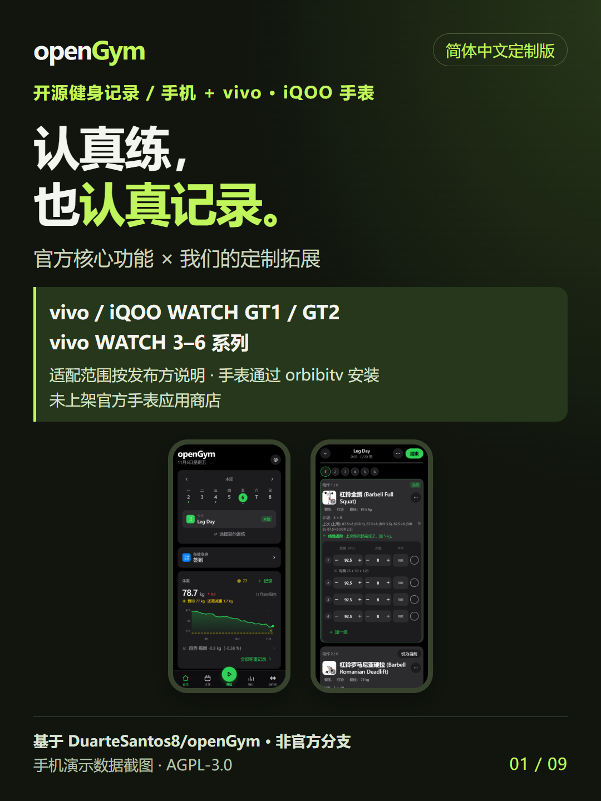
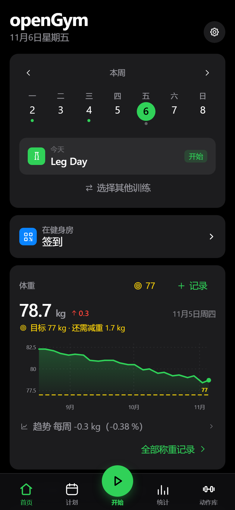
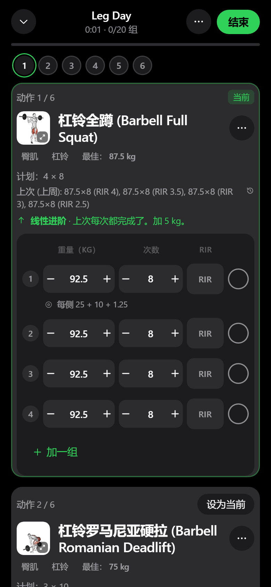
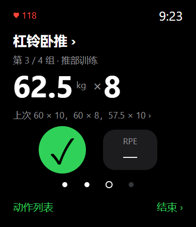
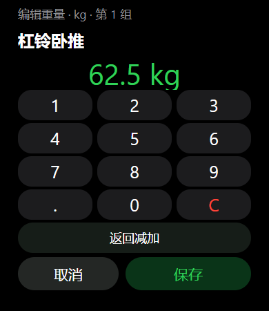

<div align="center">

# openGym 简体中文定制版

**把计划、训练记录和进步复盘，放进同一套应用。**

基于 [DuarteSantos8/openGym](https://github.com/DuarteSantos8/openGym) 的社区定制分支。<br>
保留官方核心能力，重点完善简体中文体验、AI 对话改计划和 vivo / BlueOS 手表训练。

**简体中文** · [English / 原英文说明](README.en.md)

[](https://github.com/daoshi818-crypto/openGym/releases/latest)
[](https://github.com/daoshi818-crypto/openGym/actions/workflows/build.yml)
[](LICENSE)

[下载安装](https://github.com/daoshi818-crypto/openGym/releases/latest) · [七张功能短图](docs/showcase/README.zh-CN.md) · [官方原项目](https://github.com/DuarteSantos8/openGym) · [自托管文档](docs/SELF_HOSTING.md)



</div>

> 本仓库不是官方发行渠道，也不把上游已有能力当作原创。下文明确区分「官方核心功能」与「本分支拓展」。功能对照以已核对的官方 v1.4.4 为固定基线，不代表对上游未来版本的判断。

## 一、官方核心功能：从计划到复盘

这些能力源于官方项目，本定制版予以保留或适配；具体可用范围以当前界面、模块设置与部署配置为准。

| 功能 | 可以做什么 |
| --- | --- |
| 训练计划 | 按周或轮换安排训练，自定义动作、组数、次数、休息时间，使用入门模板。 |
| 逐组记录 | 记录重量、次数、训练时长和可选 RPE / RIR；休息倒计时、上次表现、个人纪录辅助训练。 |
| 动作库与手机动作示范 | 按肌群、器械搜索动作，在手机端查看示范和训练要领；支持自定义动作。 |
| 进步统计与报告 | 训练日历、趋势、容量、体重和肌群统计；查看阶段报告，使用系统打印保存 PDF。 |
| AI 教练 | 训练问答、复盘、计划生成与调整建议；需要配置兼容的 AI 服务或自己的密钥。 |
| 数据自主 | 本地优先、离线记录、备份导入导出，可选自托管与多端同步。AI 和在线同步仍需对应服务。 |

<table>
<tr>
<td align="center"><br><b>今日计划</b></td>
<td align="center"><br><b>逐组训练记录</b></td>
</tr>
</table>

## 二、我们的拓展：中文体验与 vivo 手表

### 1. AI 普通聊天，也能走到「确认改计划」

不必只从「复盘 → 改进计划」进入。普通对话可返回回答、澄清或结构化调整方案；先看变更，再由你明确确认应用。

> 示例需求：**「我想把练背除了第一个动作以外，其他改为三组。」**
>
> 预期范围：保留第一个动作，其他目标动作设为 3 组；方案经校验并确认后，只修改后续计划模板，不改本场训练和历史。

- 支持修订方案、范围校验、旧值检查、过期拦截与重复应用保护。
- 1.6.12 完善组数整数格式兼容及输入法布局；不对任意模型的输出作成功保证。
- 手机自带 Key 模式使用随 APK 更新的共享核心；自建教练服务需要同步部署匹配 API，旧服务兼容只读回答。
- AI 服务会按配置接收对话和必要训练上下文；并非无需配置、无需联网的免费离线模型。

### 2. vivo / BlueOS 手表：围绕训练重做交互

官方已有 Apple Watch / Wear OS 支持；我们另外实现 **BlueOS 工程与方屏、圆屏 RPK**，不是把官方 Swift / Kotlin 安装包直接装到 vivo 手表。

- **GT1 方屏 390×450 适配**：重点修正当前组、已完成组、精确键盘和首页的布局。
- **点击动作名切换动作**，参考 Wear OS 的入口逻辑。
- **圆点选择组、选字段后用表冠调值**，参考 Apple Watch 交互，并保留取消、保存与已完成组保护。
- 查看 Last Time、组间休息、RPE / RIR、结束确认与训练总结；手机作为训练数据的事实来源。
- 加强双端事件确认、离线待发送队列及过期编辑保护；手表开练成功后，运行中的手机切换至训练页。

<table>
<tr>
<td align="center"><br><b>当前组 · 代码预览</b></td>
<td align="center"><br><b>精确录入 · 代码预览</b></td>
</tr>
</table>

> 手表图为真实页面代码生成的浏览器预览，不是真机截图。固件字体、触控、表冠与锁屏/后台恢复仍需实机验收；不承诺从被杀进程的手机强制拉起应用。**当前版已移除手表动作演示与图片帧传输，手机动作示范保留。** 长列表与历史页面保留必要滚动，并非所有页面强行一屏显示。

### 3. 简体中文动作资料完善

官方本来就有中文界面与动作本地化；本分支进一步补充、校正简体中文动作名称与训练要领。此前内容快照中有 **5,454 个动作提供中文要领**，存在歧义的项目保留待审，不将未审内容强行填充，也不声称每条步骤均经人工专业审校。

### 4. 手机更新与发布闭环

- 应用检测更新指向本仓库自己的 GitHub Release，提供 CDN 与源站元数据兜底。
- 手机 APK、方屏/圆屏手表包与 SHA-256 校验文件统一发布；构建与测试通过后才更新 `update.json`。
- 持续修复输入法避让、训练同步与页面布局等体验问题；统计页仅保留趋势内原有报告入口，移除外层重复按钮。

详细归属与限制：[功能对照基线](docs/dev/FORK_VS_OFFICIAL_1_6_9.zh-CN.md) · [GT1 交互和实机验收](docs/dev/WATCH_GT1_UI_REBUILD.zh-CN.md) · [1.6.14 发布说明](docs/dev/RELEASE_1_6_14.zh-CN.md)

## 下载与安装

请到 **[本仓库 Releases](https://github.com/daoshi818-crypto/openGym/releases/latest)** 下载，不要把官方 APK 与定制版更新源混用。

| 文件 | 用途 |
| --- | --- |
| `openGym.apk` | Android 手机端。 |
| `opengym-watch-<版本>.rpk` | vivo / BlueOS 方屏手表，GT1 使用这一包。 |
| `opengym-watch-round-<版本>.rpk` | 支持的 BlueOS 圆屏设备，不是 Wear OS / Apple Watch 安装包。 |
| `*.sha256` | 对应安装包的 SHA-256 校验值。 |

当前文档快照：手机 **1.6.14 / code 60**，手表 **0.6.18 / code 33**。以后续 Release 为准。建议先导出手机数据、确认手表待上传记录已同步，再按兼容的签名和版本覆盖升级；不建议为更新随意卸载或清除数据。

手机内使用「设置 → 检查更新」。手表安装与配对请参阅 [watch-app/README.md](watch-app/README.md)，真机兼容性以设备安装结果为准。

## 自托管与源码开发

仅在手机本地使用，不需要先部署服务器。需要自托管账号、同步或服务端 AI 时，阅读 [自托管指南](docs/SELF_HOSTING.md) 与 [AI 教练配置](docs/AI_COACH.md)。

```bash
git clone https://github.com/daoshi818-crypto/openGym.git
cd openGym
cp .env.example .env
docker compose up -d --build
```

访问 `http://localhost:8080`。跨设备使用 Passkey 需要合适的 HTTPS / 域名配置。此处使用 `--build` 构建本分支源码；直接拉取上游预构建镜像不会自动带上本分支修改。Android APK 的发布也不等于你的 API 服务器已经部署更新。

开发与完整配置参考：[原英文说明](README.en.md) · [贡献指南](CONTRIBUTING.md) · [安全说明](SECURITY.md) · [上游变更记录](CHANGELOG.md) · [本分支发布记录](docs/dev/RELEASE_1_6_13.zh-CN.md)

## 手机阅读与社交分享图片

采用 **7 张独立短图，全部为 1080×1440（3:4）**，一张一个主题，不再使用拼接长图。按下列顺序发布即可：

| 顺序 | 图片 | 归属 |
| --- | --- | --- |
| 01 | [封面：认真练，也认真记录](assets/showcase/opengym-cover.png) | 总览 |
| 02 | [计划与逐组记录](assets/showcase/opengym-02-official-training.png) | 官方核心功能 |
| 03 | [统计与复盘](assets/showcase/opengym-03-official-progress.png) | 官方核心功能 |
| 04 | [动作库、AI 与数据自主](assets/showcase/opengym-04-official-tools.png) | 官方核心功能 |
| 05 | [AI 对话到确认改计划](assets/showcase/opengym-05-custom-coach.png) | 我们的定制拓展 |
| 06 | [vivo / BlueOS 手表训练](assets/showcase/opengym-06-custom-watch.png) | 我们的定制拓展 |
| 07 | [中文资料与发布更新](assets/showcase/opengym-07-custom-ecosystem.png) | 我们的定制拓展 |

[可编辑 HTML、制作说明与重导出脚本](docs/showcase/README.zh-CN.md)。手机图为应用演示数据截图；手表图为代码生成预览，非真机截图。流程图仅解释操作，不伪装成模型回复。发布时请保留功能归属和预览标记。

## 致谢与许可证

感谢 **Duarte Santos** 与 [官方 openGym 项目](https://github.com/DuarteSantos8/openGym) 及社区贡献者。本分支是在其开源工作基础上的拓展，不隶属于 vivo、Apple 或 Google，也不代表这些厂商背书。

源码遵循 [GNU AGPL v3.0](LICENSE)，第三方素材及附加声明见 [NOTICE.md](NOTICE.md)。上游版权与第三方声明均保留；「非商用」并不替代许可证义务。
