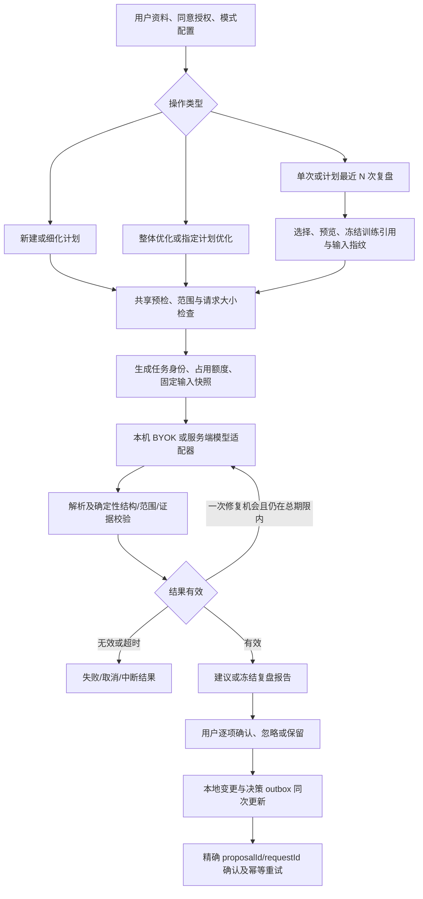

# AI 教练、训练热量与手表端实施报告

日期：2026-10-23。代码目录：`C:\Users\Administrator\Documents\ChatGPT\opengym\source`。
实施基线：`162a916f`；依据上级目录 `AI_COACH_CALORIES_SOL_IMPLEMENTATION_PLAN.md`。用户已授权实施。

## 交付状态

手机热量展示、单次/计划训练复盘、AI 任务与建议安全保护、手表同步相关代码已实现；修改保留在本地工作区。Web、移动端网页资源、方屏与圆屏手表均构建通过。本轮没有调用真实付费模型，没有提交、推送、发布、安装或修改签名。

代码验证不等于真机和上线验收。原生安全存储、手表熄屏/后台心率、原生异步存储回调永久丢失、跨设备并发等限制见后文。全量测试目前没有全部通过，不能据此声明可直接发布。

## 用户可见变化

1. 训练详情和训练完成页采用同一热量卡片，主数值默认 26px、单位 15px，沿用现有界面字体、圆角、颜色和图标；历史训练列表增加紧凑热量信息。缺失值显示“未记录”，真实 0 保留，部分数据保留说明，均标注“手表估算”。
2. AI 教练菜单增加“选择训练复盘”；训练详情提供“复盘本次训练”。可按名称/日期查找历史训练，预览日期与时间后确认。同日先胸后腹，选择胸部时目标保持为胸部，不会自动改成最近的腹部。
3. 选择指定计划后，可复盘最近 3、5、10 次训练。先按稳定计划 ID 筛选，再取最近 N 次。记录不足时说明实际数量；混合训练只纳入能明确归属该计划的动作，整场热量和时长不按比例猜分。
4. 复盘报告记录本次所选训练、数据范围及冻结统计。确认后新增训练不会改变本次目标；所选训练被修改或删除时要求重新选择。复盘不会直接修改计划，也不推进自动计划优化的节奏。
5. 应用建议、忽略建议及保留复盘均有身份绑定和幂等保护；确认失败保留待同步状态。撤销前检查是否有后续手工修改，防止覆盖。

## AI 教练当前逻辑

模型负责提出内容；授权、训练目标、计划范围、单位、应用条件和报告引用由代码检查。任务取消和切换身份后，旧响应不能写入新任务。无法由代码验证的自然语言判断仍需实际模型质量验收。

## 方案逐项落实

| ID | 实现与主要位置 | 验证/边界 |
|---|---|---|
| C01 | `WorkoutCalories.jsx`、`sheets.jsx`、局部 CSS；详情读取最新训练记录，保留笔记草稿 | 16 组屏宽/主题/字号视觉检查；截图及 JSON 见下 |
| C02 | `workout-calories.js` 严格数值选择；`watch-session/recovery` 等分段汇总 | 覆盖缺失、0、损坏、分段、重发、乱序和下降更正；不额外估算热量 |
| A01 | `coach-local.js` 同步启动锁、独立任务上下文、generation/abort、持久 current/last | 并发、取消、忘记后晚结果及重启中断专项通过 |
| A02 | `coach.js` 决策账本/outbox；客户端及 API 精确身份确认；创建计划使用稳定导入 ID | 同设备幂等、旧确认不清新建议、错账号 outbox 暂缓；跨设备合并仍需实测 |
| A03 | 共享 `dates.js` 和复盘窗口处理 | 时间戳/合法日期与窗口边界专项通过 |
| A04 | `coach-credential-scope.js`、`coach-secrets.js`、`CoachSetup.jsx`；端点绑定凭据、严格原生失败反馈 | Web 凭据仅本次进程内存；原生安全存储失败不静默降级；原生插件需真机 |
| A05 | `coach-device.js` 串行设备存储、双槽校验和/版本、损坏回退；启动错误不阻断训练 | 损坏新槽回退、全坏拒绝覆盖、失败反馈专项通过；断电需真机 |
| A06 | HTTP body 纳入期限、流式 2MB 上限、取消分类；pipeline 修复共享总预算；原生 fetch 取消透传 | 模拟挂起/超大响应/提前取消通过；无流式 reader 的原生路径仍是完整读取后限长 |
| A07 | `scope.js`、preflight、validator、应用前再次检查指定 routine 范围 | 跨计划、week 等越界输出被拒绝，修复后仍越界则失败 |
| A08 | 共享 consent/preflight、payload 上限及服务端配置对齐；OpenAPI 补充选择及决策协议 | 授权/超大请求在调用前拒绝、不扣模型额度；旧服务器不把 typed selection 静默降级 |
| A09 | `context.js` 固定单位、资料版本、计划/日程指纹；导入按生成单位处理 | 应用前再次检查资料、单位、before 值和日程条件 |
| A10 | snapshot 保存应用后指纹；`canRevert/revertLast` 拒绝覆盖之后手改 | 手改后撤销拒绝且保留快照专项通过 |
| A11 | IME composition/229/刚结束保护；轮询标记 stale，服务器/账号身份隔离 | 浏览器 IME 验证通过；旧身份晚到轮询不得更新当前状态 |
| A12 | 稳定 typed ref 精确查找；不存在/重复引用报错；历史比较不含之后训练 | 单次精确目标、历史窗口及 legacy 冲突专项通过 |
| A13 | 完整偏好日期、训练时长启发式、最近三场已完成正式组重量、实际 rotation/queue 结构 | 重复动作只占一场最近训练名额；偏好/时长测试通过；时长规则是计划合理性启发式 |
| A14 | `CoachDebriefPicker.jsx`、`debrief-selection/report`、payload/schema/prompt、local/demo/API 及报告展示 | 单次/3/5/10、稳定计划筛选、冻结选择、混合归属、趋势至少两场且动作存在，均有验证 |
| W01 | `watch-identity.js`、watch events/session/protocol；稳定 entryInstanceId/setId、删除墓碑、版本 | 重排/重复/晚到保护通过；旧下标协议遇结构变更保守拒绝 |
| W02 | 消息携带生成单位，手机发送前捕获单位/身份，接收端规范转换 | 单位与身份专项通过；旧协议及真实断连切换需设备验收 |
| W03 | `$app.$def` 共享 runtime、按 key 串行 persistence、dirty 重试、持久后发送、发送回调 6 秒 watchdog | 独立页面 bundle/延迟/失败/发送丢回调故障注入通过；存储回调永久不返回不等同于已恢复 |
| W04 | 普通关闭记录 30 天/500 条保留策略；保护未确认/正在处理记录；只重发必要记录 | 600 条清理与保护测试通过；过期/无日期离线开始拒绝，防旧会话复活 |
| W05 | 心率订阅归属于训练会话，跨页面单订阅，暂停/结束停止，恢复重启；15 秒过期显示 `♥ --` | VM 跨 bundle 和过期/状态测试通过；熄屏及固件后台限制尚未真机验证 |

## 验证证据

以下为本次实现后的结果，不能与实施前的旧审查测试混算，也不能将各批存在重叠的专项直接相加。

| 验证 | 结果 | 文件 |
|---|---|---|
| 前端相关专项，单 worker | 615 / 615 通过 | `frontend-core-final.json` |
| API 核心相关专项，串行 | 173 / 173 通过 | `api-core-final.tap` |
| 新增偏好日期/时长约束验收所在文件 | 8 / 8 通过，包含前述核心专项中 7 项及新增 1 项 | `api-quality-final.tap` |
| 媒体同步文件内存异常复核，单 worker | 31 / 31 通过 | `frontend-media-recheck.json` |
| 前端全量，本机 maxWorkers=2 | 5262 通过、14 失败，另有 mobile checker suite 加载失败；本次有内存分配异常 | `frontend-final-tests.json` |
| API 全量首次并行运行 | 592 通过、12 失败；两项队列用例随后在串行核心专项通过 | `api-final-tests.tap` |
| API 全量串行复核 | 594 通过、10 失败，无取消/跳过；运行启动后的新增 1 项偏好/时长测试另在 quality 文件通过 | `api-final-serial.tap` |
| Web 生产构建 | 通过 | `web-build.log` |
| 手机网页资源生产构建 | 单独重跑通过，产物 `checkCopy` 返回空问题列表 | `mobile-build.log`、`mobile-web-bundle/` |
| watch-square / watch-round 编译 | 两种均通过 | `watch-*-build.log` |
| 方/圆屏布局校验 | 各 5 个页面均通过 | `watch-*-layout.log` |
| 视觉/交互 | 16 组合无溢出，长数值/英文、胸部选择及 IME 通过，浏览器 errors 为空 | `visual-qa.json`、`visual-qa.cjs` |
| 文案与差异检查 | 18 个语言包各 2341 键一致，1838 个源码翻译字符串均有对应键；默认 Git diff whitespace 检查通过 | `check-locales.mjs`、`check-source-strings.mjs`、`git diff --check` |

视觉覆盖 320/360/390/430 CSS px × 深浅主题 × 根字号 16/32px；热量数字计算字号为 26/52px，来源文案最低对比度 9.23:1。截图：`calories-320-light-2x.png`、`calories-320-dark-2x.png`、`calories-390-light-1x.png`、`calories-390-dark-1x.png`、`debrief-chest-preview.png`。截图使用隔离演示 fixture，不是真实用户训练记录。

全量前端失败涉及：9 项 Windows 无 POSIX shell 的入口脚本测试，FIT 文件名/训练窗口的时区断言，固定日期的 demo fixture，精简检出缺少 `mcp/src`，以及一次媒体测试内存分配失败。媒体文件已单独重跑通过。mobile checker 在 Vitest 内报语法加载错误；Node 原生执行实际构建产物检查通过。未通过修改这些无关产品逻辑来掩盖环境问题。

API 串行全量剩余 10 项：6 项 POSIX 文件/目录权限及不可写目录假设，3 项缺失的 kubernetes/helm/api scripts 文件，1 项邮件密码注册接口错误码规格检查。先前两项 AI 队列用例在串行全量及核心专项均通过。原始日志保留。不能将这 10 项失败标成通过，也未为清空失败而扩展修改注册、部署和媒体模块。

构建仍有既有大 chunk、动态导入无拆分效果及 Tailwind 配置警告。新增文案进入现有语言键集合，简繁中文有对应文案；其他语言部分新增文本仍采用项目现有英文回退策略，不代表完成了专业翻译。

## 真机和部署前仍须验收

| 场景 | 操作与通过条件 |
|---|---|
| 原生安全存储 | 写入/读取/删除失败、切换服务商和端点、重启后禁用残留凭据；不得发送旧端点密钥 |
| 存储回调故障与断电 | 写盘期间杀进程/断电、写失败重试、回调永不返回；重启读取最后完整版本，未持久化事件不丢失或误确认 |
| W03 未决边界 | 发送回调丢失已有 watchdog；原生存储操作永久无回调时仍保留 busy，避免并发旧写覆盖。需要原生读回/重启证据才能确定安全恢复策略 |
| 手表会话与心率 | 页面切换、熄屏、后台、暂停/恢复/结束；验证 `$app.$def` 所有页面共享同一 owner，确认固件是否允许后台采样，旧值不继续冒充实时 |
| 手表离线与重排 | 断连后双方重排/删除/加组、单位切换，再连接；事件只落到原动作和组，重复不增记 |
| 手机实际字体与辅助功能 | Android/iOS 系统字体缩放、中文/英文、详情/完成/历史一致、手表热量晚到且笔记草稿保留 |
| 多设备与协议升级 | 两手机接收同建议、离线接受后同步、稳定导入 ID 去重、旧版本 API 明确拒绝新选择协议；本轮未验证跨设备 exactly-once |
| 实际模型内容质量 | 使用获准模型验收合理训练建议、短样本不编造趋势、限制条件遵循、中文内容质量；本轮全部使用 mock/fixture，无真实模型调用证据 |

## 后续优化建议

优先完成上述真机矩阵和部署环境的全量复测，再考虑增加报告间对比、复盘收藏筛选和建议效果回访。计划最近 N 次复盘目前强调可核对的训练证据；缺少动作归属的旧混合记录只允许整次复盘。若需要将其拆到计划，需要先提供可审查的历史归属编辑功能。

自然语言解释仍可能有质量问题，现有结构校验不能证明每句话都正确；建议用匿名固定样本建立胸/腹同日、跨单位、混合训练、短样本和伤病限制等模型回归集，并在后续明确授权后执行真实模型评估。
