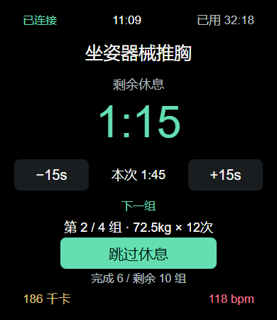
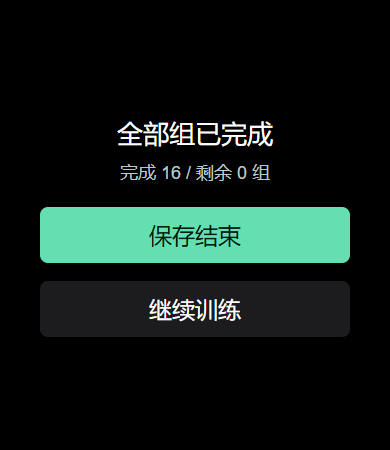
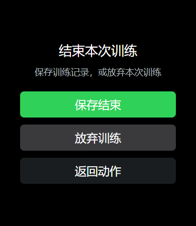
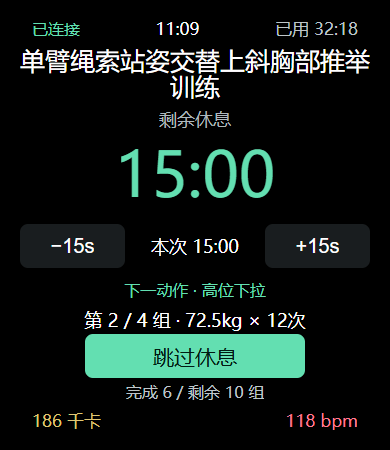

# opengym 手表 0.6.6

- 修复动作页再次右滑后结束面板闪回：同次滑动只消费一次，抬手或取消后继续保护 400ms，阻止系统返回和新面板误触；后续主动返回、左滑仍可返回动作页。
- 所有组完成时显示“保存结束 / 继续训练”。选择继续后，页面恢复或重复同步不再反复提示；新增组或撤销完成后，再次全部完成会重新提示。保存沿用可靠的会话关闭和总结同步流程。
- 休息倒计时保留 62px 字号，增加文字区域高度、显式行高和下方间距；跳过休息与组数统计保持间距。
- 保留 0.6.5 的跨动作上下组导航和手机焦点同步。

版本：0.6.6（code 21），390×450 矩形 watch-square 目标。手机无需更换 APK。

验证：95 项手表业务测试、17 种布局状态、字体行框/字形空间与元素相交检查通过；官方 BlueOS 编译、5 个编译后页面和倒计时原生样式检查通过。HTML 预览不等同于真机；实物触摸、表冠和字体显示仍待安装复核。

RPK SHA256：`2dfc92e2a0a5761f985ca861850448fa3f441df1b42263343d7152a28e72ee93`

## 页面预览

